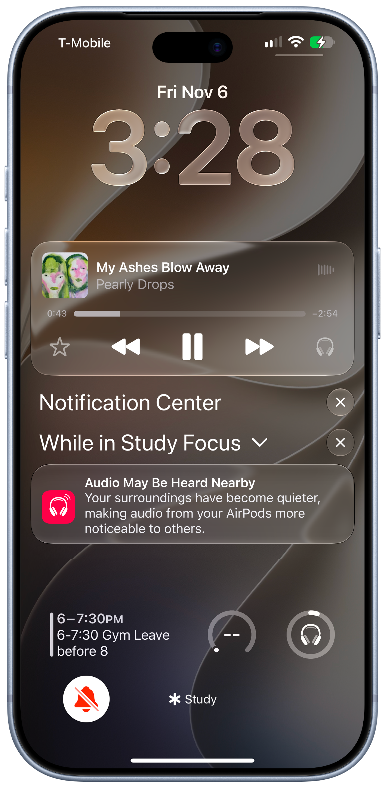

# Sound Awareness

### Discretion Mode
New listening mode for AirPods.

Discretion Mode notifies users when audio from their AirPods may be audible to people around them, helping maintain a more private listening experience.

## Overview

Sound Awareness explores how AirPods could help users become more conscious of sound leakage while listening to music, watching videos, or taking calls.

### Example

  

